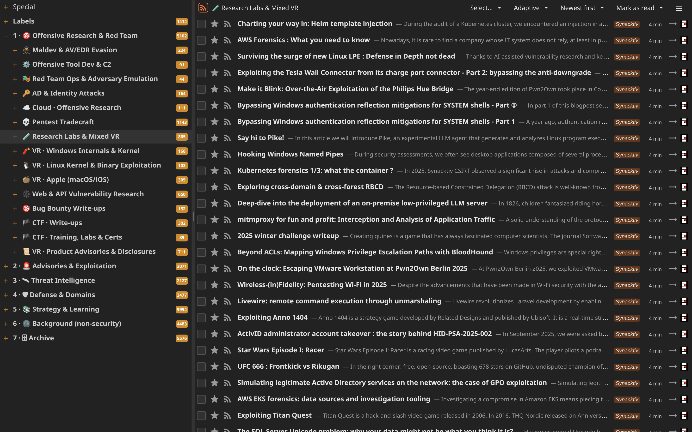
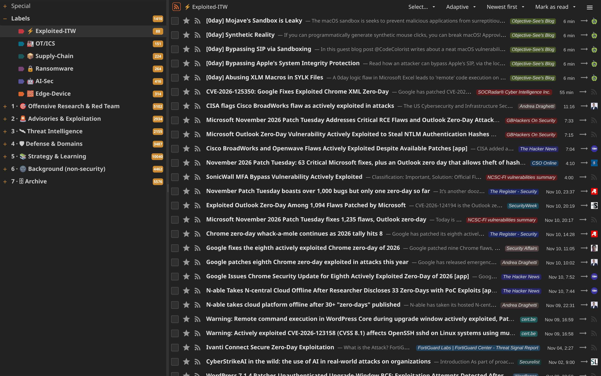
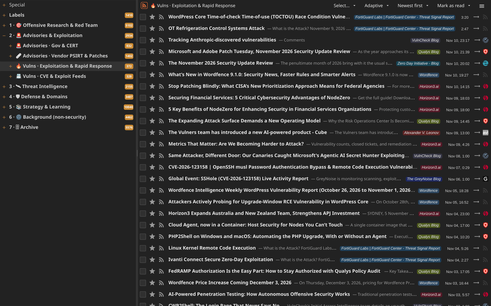
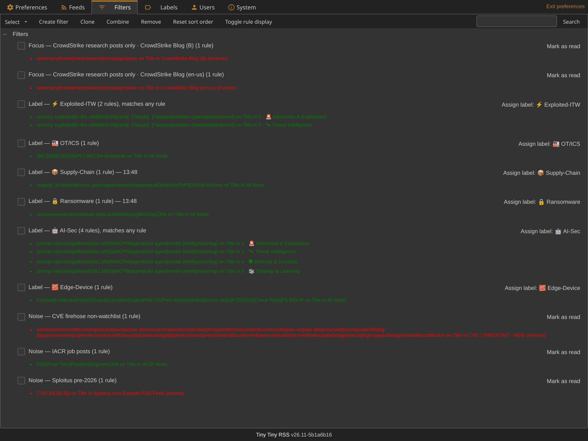
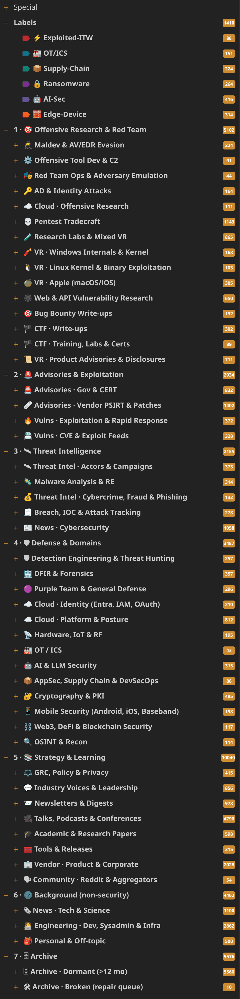

# CybeRSS

**Cybersecurity RSS and Atom feeds, curated into categories and tiers, offensive research first.**

Import one OPML file into any feed reader, or load the [Tiny Tiny RSS](https://tt-rss.org/) version, which adds triage labels and filters.



## Quick start

**Any feed reader.** Import [`feeds.opml`](feeds.opml). Categories arrive as nested folders, tier first. Each tier is also a separate file in [`opml/`](opml/).

**Tiny Tiny RSS.** Import [`tt-rss/feeds-ttrss.opml`](tt-rss/feeds-ttrss.opml) under **Preferences → Feeds → OPML**. It adds the feeds, labels and filters.

**From nothing, with Docker:**

```bash
git clone https://github.com/inneromost/CybeRSS.git
cd CybeRSS/tt-rss
cp .env.example .env            # then change both passwords in .env
docker compose up -d

docker compose cp feeds-ttrss.opml app:/tmp/feeds-ttrss.opml
docker compose exec app chmod 644 /tmp/feeds-ttrss.opml
docker compose exec -u app app \
  php /var/www/html/tt-rss/update.php --opml-import admin:/tmp/feeds-ttrss.opml
```

Open <http://127.0.0.1:8280/tt-rss/> and log in as `admin`. Fetching only starts after that first login.

## What is inside

<!-- stats:start -->
| tier | categories | feeds | read it for |
|---|---:|---:|---|
| [1 · 🎯 Offensive Research & Red Team](opml/1-offensive-research-red-team.opml) | 15 | 236 | Maldev and EDR evasion, C2 and tooling, AD and identity attacks, vulnerability research by platform, web and API research, bug bounty and CTF write-ups. |
| [2 · 🚨 Advisories & Exploitation](opml/2-advisories-exploitation.opml) | 4 | 47 | What needs action: CERT alerts, vendor bulletins, in-the-wild exploitation, raw CVE and exploit streams. |
| [3 · 🛰 Threat Intelligence](opml/3-threat-intelligence.opml) | 5 | 102 | Actors and campaigns, malware analysis, cybercrime and fraud, breach tracking, security news. |
| [4 · 🛡 Defense & Domains](opml/4-defense-domains.opml) | 13 | 131 | Detection engineering, DFIR, purple teaming, plus cloud, hardware and RF, OT/ICS, AI security, supply chain, cryptography, mobile, Web3, OSINT. |
| [5 · 📚 Strategy & Learning](opml/5-strategy-learning.opml) | 8 | 205 | Policy and privacy, practitioner commentary, newsletters, talks and podcasts, papers, tool releases, vendor blogs, aggregators. |
| [6 · 🌚 Background (non-security)](opml/6-background-non-security.opml) | 3 | 151 | General tech news, engineering blogs, off-topic personal blogs. |
| [7 · 🗄 Archive](opml/7-archive.opml) | 2 | 444 | No post in over a year, or currently failing. Kept because old research stays useful and blogs come back. |
| **total** | **50** | **1,316** | |
<!-- stats:end -->

Every feed by category, with site and feed links: **[FEEDS.md](FEEDS.md)**. As a spreadsheet: [`feeds.csv`](feeds.csv).

Feeds are filed by what they publish, not by their name. Feeds marked ⏸ in FEEDS.md are paused.

## Labels and filters

Tiny Tiny RSS file only. Matched on the article title.

| label | applies to | fires on |
|---|---|---|
| ⚡ Exploited-ITW | tiers 2 and 3 | actively exploited, in the wild, KEV, zero-day |
| 🧱 Edge-Device | every feed | Fortinet, Ivanti, Citrix, PAN-OS, SonicWall, Cisco ASA/FTD/IOS, Check Point, F5 BIG-IP |
| 🤖 AI-Sec | tiers 2 to 5 | prompt injection, jailbreak, LLM, MCP, agentic |
| 🔒 Ransomware | every feed | ransomware, extortion, leak site, named crews |
| 📦 Supply-Chain | every feed | supply chain, malicious package, typosquat, npm, PyPI, GitHub Actions |
| 🏭 OT/ICS | every feed | ICS, SCADA, PLC, ICSA advisories |

| read-on-arrival filter | what stays unread |
|---|---|
| CVE firehose | Entries naming widely deployed products (Microsoft, edge appliances, VMware, browsers, Linux kernel, …) |
| CrowdStrike blogs | Posts about adversaries, threats, intelligence, research or campaigns |
| IACR news | Everything except job and position announcements |
| Sploitus | Exploits for CVEs from 2026 onwards |

Exact expressions and scopes: **[docs/TRIAGE.md](docs/TRIAGE.md)**. Edit them under **Preferences → Filters**.



<details>
<summary><b>More screenshots</b></summary>
<br>






</details>

## Contributing

Found a dead, moved or hijacked feed, or have one to suggest? [Open an issue](https://github.com/inneromost/CybeRSS/issues/new/choose).

## Credits and license

Seeded from the [Bad Sector Labs "Last Week in Security" blog list](https://blog.badsectorlabs.com/files/blogs.txt), [phretor/infosec-opml](https://github.com/phretor/infosec-opml), the awesome-security-feed list and x33fcon speaker pages. Curated in [Tiny Tiny RSS](https://tt-rss.org/).

[MIT](LICENSE) for the script and the list as compiled. The feeds and everything they publish belong to their authors.
